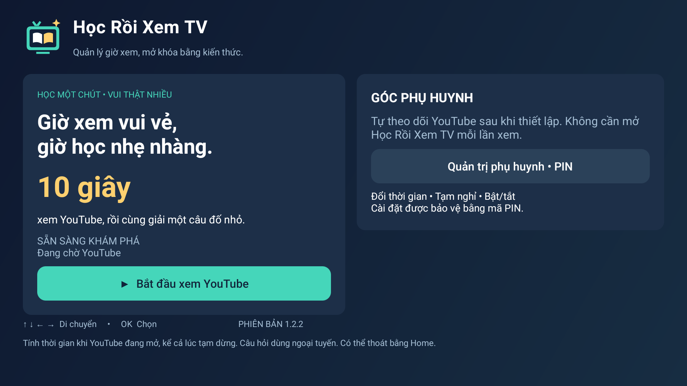
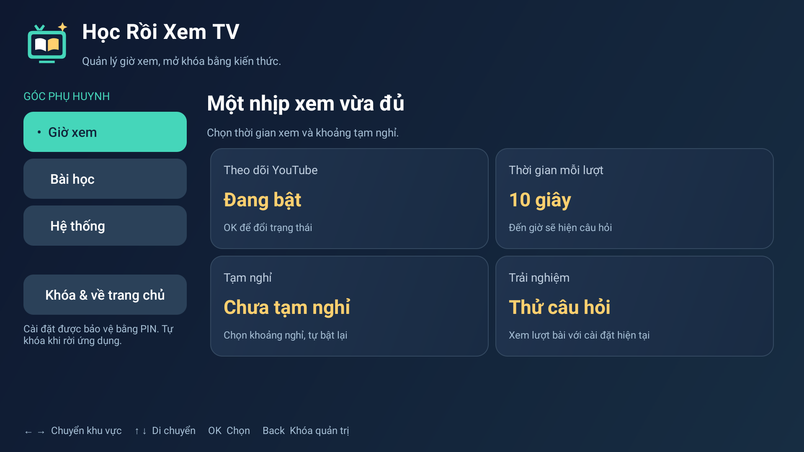
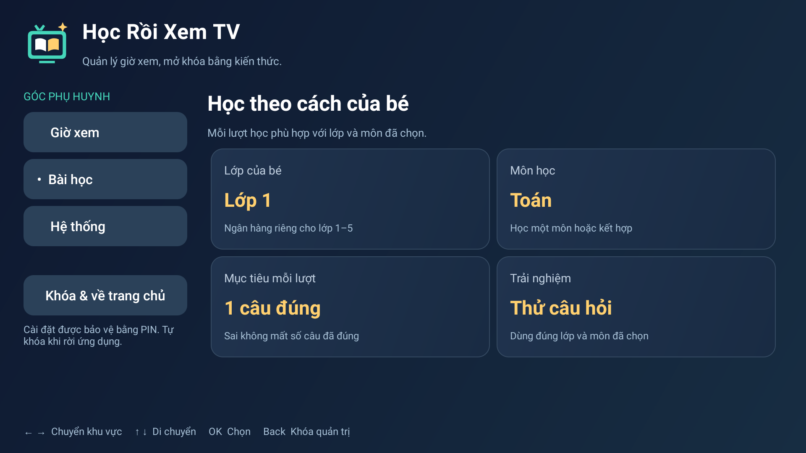
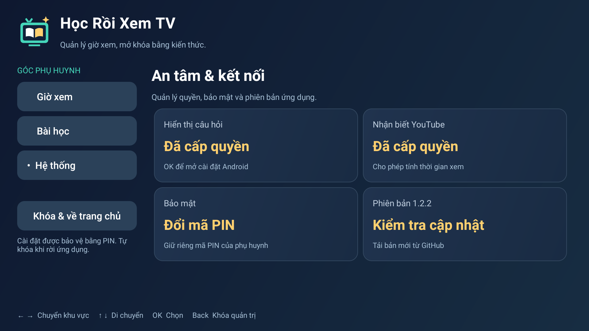
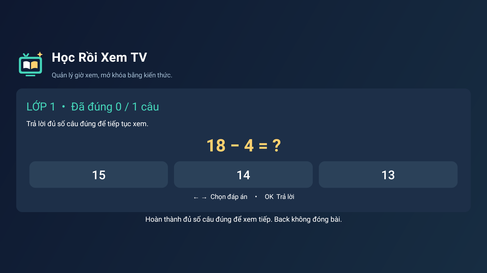

# 📺 Học Rồi Xem TV — v1.2.2

*Quản lý giờ xem, mở khóa bằng kiến thức.*

Ứng dụng Android TV giúp phụ huynh quản lý bé xem YouTube: đến giờ, bé cần hoàn thành câu hỏi để xem tiếp.

**[⬇ Tải APK v1.2.2](https://github.com/dinhchi27/hoc-roi-xem-tv/releases/download/v1.2.2/Hoc-Roi-Xem-TV-v1.2.2.apk)** · [Hướng dẫn sử dụng](HUONG-DAN.md) · [Changelog](https://github.com/dinhchi27/hoc-roi-xem-tv/releases/tag/v1.2.2)

## Tính năng

- ⏱️ Tự đếm thời gian mở YouTube; tùy chỉnh giờ xem và khoảng tạm nghỉ.
- 🔓 Yêu cầu **1–20 câu đúng** mỗi lượt, lưu tiến độ khi rời app.
- 📚 **888 câu Toán + 100 câu Tiếng Việt**, lớp **1–5**, dùng ngoại tuyến.
- 🔐 Quản trị bằng **PIN**, chia ba nhóm **Giờ xem · Bài học · Hệ thống**.
- 🎮 Điều khiển bằng remote, có chức năng kiểm tra cập nhật từ GitHub.

## Cài đặt nhanh

1. Tải APK phía trên và chuyển sang TV bằng **USB** hoặc **[LocalSend](https://localsend.org/download)**. Với LocalSend: cài trên cả điện thoại iOS/Android và TV, kết nối cùng mạng, chọn APK để gửi và chấp nhận trên TV.
2. Mở APK bằng trình quản lý tệp; cấp quyền **Cài ứng dụng không rõ nguồn gốc** nếu được hỏi.
3. Mở app, tạo PIN và cấp quyền **Hiển thị câu hỏi**, **Nhận biết YouTube**. Bật tự động theo dõi, chọn thời gian và bài học.

**Chuyển từ bản cũ:** v1.2.2 dùng mã định danh mới `vn.hocroixemtv`, cài thành ứng dụng riêng và cần thiết lập lại. Tắt theo dõi ở app cũ để tránh chạy trùng; không chuyển sang bản này qua OTA cũ.

## Giao diện trên TV

Ảnh thật từ Sony Bravia 4K UR3, Android TV 10, app v1.2.2.

| Trang chính | Giờ xem |
| --- | --- |
|  |  |

| Bài học | Hệ thống |
| --- | --- |
|  |  |

Xem màn hình câu hỏi

## Tài liệu

- [Cài đặt, quản trị, cập nhật và build](HUONG-DAN.md)
- [Ngân hàng Tiếng Việt và đáp án](NGAN-HANG-TIENG-VIET.md)

**Lưu ý:** thời gian được tính khi YouTube đang mở, kể cả lúc tạm dừng. App không khóa nút Home/cài đặt Android; khả năng chạy nền phụ thuộc TV. Câu hỏi là bài ôn tập cơ bản. Chưa có trên Play Store.
